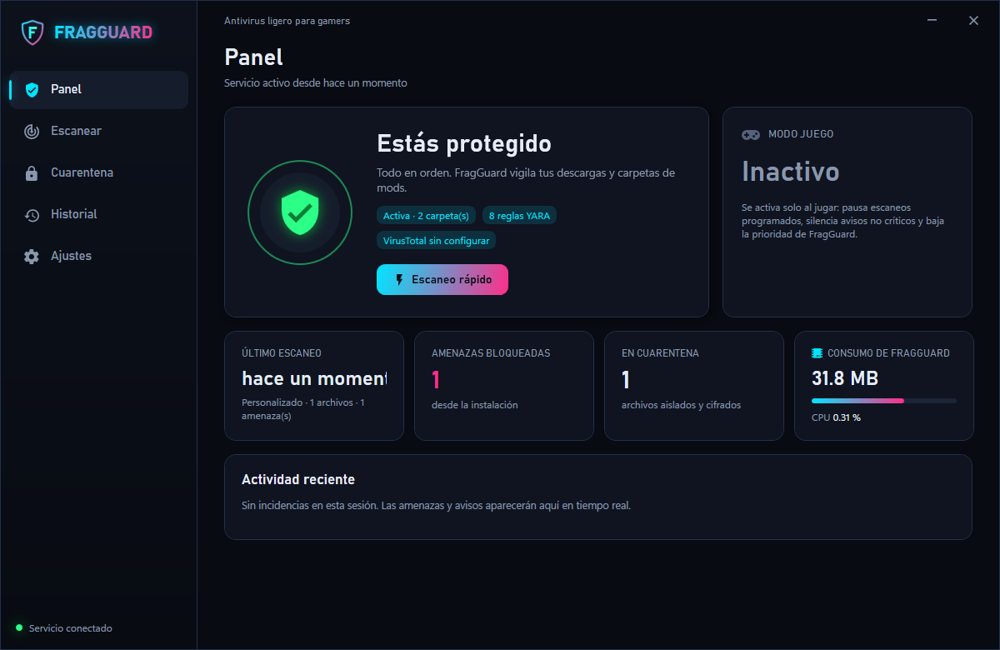
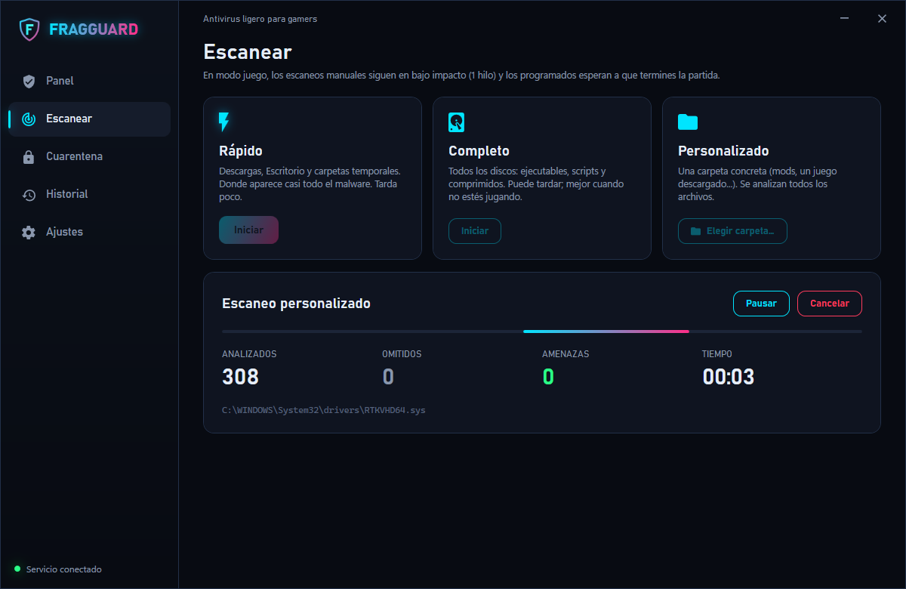
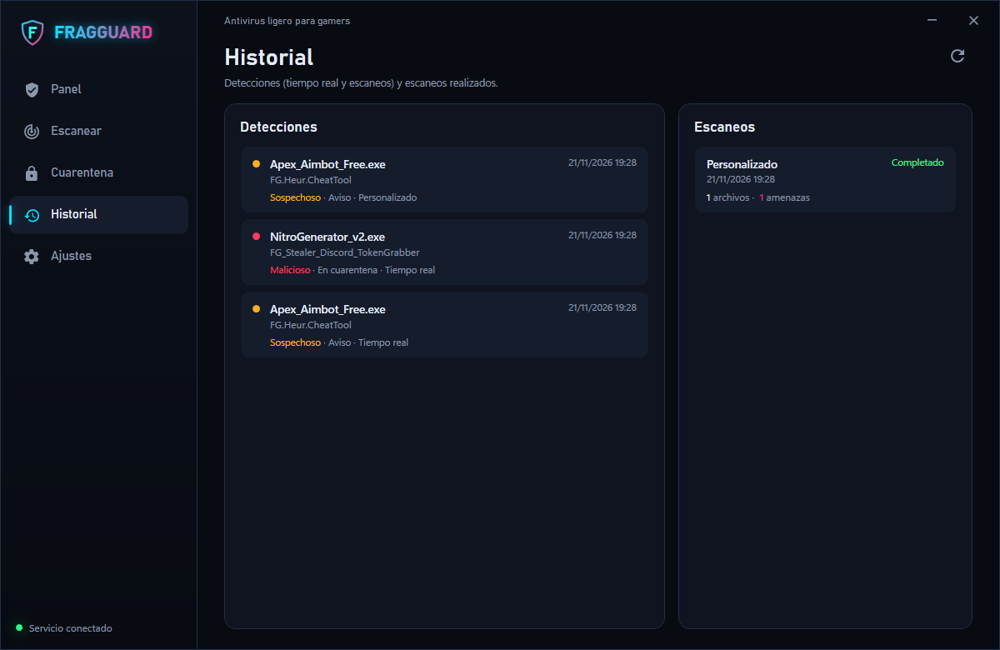

<div align="center">


# FragGuard

**Antivirus ligero para gamers en Windows 10/11.**
Protege tus cuentas de Discord y Steam sin robarte ni un FPS.


[](https://github.com/josedjj/FragGuard/actions/workflows/build.yml)

</div>

---

<p align="center">
  
</p>

## ¿Por qué FragGuard?

Los jugadores son uno de los objetivos favoritos de los **infostealers**: programas que se hacen pasar por cheats, "free skins", generadores de Robux o V-Bucks, o mods, y que en segundos roban tu **token de Discord**, tu **sesión de Steam** (y con ella tu inventario) y las contraseñas guardadas en el navegador.

FragGuard está pensado para eso, y para no molestar mientras juegas.

### 🎮 Modo juego automático
- Detecta cuándo estás jugando: juegos conocidos, juegos lanzados desde **Steam, Epic, Battle.net o Riot**, o cualquier aplicación a pantalla completa.
- Mientras juegas, **pausa los escaneos programados**, **silencia los avisos no críticos** y **baja su propia prioridad de CPU y disco**.
- Al cerrar el juego, todo vuelve a la normalidad automáticamente.

### 🪶 Consumo mínimo
- Con todas las protecciones activas, el servicio se mantiene **por debajo de 50 MB de RAM** (unos 40 MB en reposo) y casi no usa CPU.
- La ventana solo consume recursos mientras la tienes abierta. Al cerrarla, FragGuard se queda en la bandeja del sistema.

### 🛡️ Protección pensada para gamers
- **Tiempo real** sobre tu carpeta de **Descargas** y las **carpetas de mods** que elijas.
- Detección de **robo de tokens de Discord**, **sesiones de Steam**, **contraseñas y cookies de navegadores** (Chrome, Edge, Brave, Opera GX, Firefox...).
- **Aviso especial** cuando descargas o ejecutas archivos con nombre de cheat, trainer, inyector, spoofer o "free skins". Además de ser malware a menudo, pueden costarte un **baneo**.
- Revisa también el **interior de los .zip, .rar y .7z** sin extraerlos.
- Consulta opcional a **VirusTotal** y a **MalwareBazaar / URLhaus** de abuse.ch (con tus propias claves gratuitas). Solo se envía la huella del archivo o la dirección desde la que se descargó, **nunca el archivo**.
- Reconoce los programas **firmados por editores de confianza** (Valve, Riot, Epic, NVIDIA...) para no darte falsas alarmas, y avisa de **programas no deseados** y **mineros de criptomonedas** ocultos.
- Las **reglas de detección se actualizan solas** y van **firmadas digitalmente**: FragGuard rechaza cualquier actualización que no venga de nosotros.

### 🧠 Vigilancia mientras usas el PC
- **Comportamiento sospechoso**: detiene al momento los comandos típicos del malware, como borrar las copias de seguridad de Windows, desactivar Windows Defender o lanzar PowerShell oculto.
- **Escudo anti-ransomware**: archivos trampa ocultos en tus carpetas personales. Si un programa empieza a cifrarlos o a renombrar archivos en masa, FragGuard lo detiene y lo aísla.
- **Protección de cuentas**: si un programa que no es Discord, Steam o tu navegador intenta leer tus tokens, sesiones o contraseñas guardadas, lo detiene.
- **Cámara y micrófono**: te avisa si un programa desconocido empieza a usarlos.
- **Inicio de Windows**: revisa qué programas arrancan solos y te deja **desactivarlos y restaurarlos** con un clic. También avisa si alguien añade exclusiones a Windows Defender.
- **Memorias USB**: analiza las unidades en cuanto las conectas y las vigila mientras estén conectadas.
- **Análisis de memoria** bajo demanda de los programas en ejecución (nunca mientras juegas).

### 🌐 Protección en la red
- **DNS protegido** opcional con un clic (Quad9, cifrado): bloquea dominios de malware y phishing en todo el equipo y se puede desactivar volviendo a tu configuración anterior.
- **Extensión para Chrome y Edge** que bloquea más de **21.000 webs de estafas** de Discord Nitro, Steam y skins gratis. No lee tus páginas ni tu historial.

### 🕹️ Tus juegos, bajo control
- Lista **todos tus juegos instalados**: Steam (todas tus bibliotecas), Epic, Riot, EA, Ubisoft, GOG, Battle.net y Rockstar.
- Muestra **cuándo los jugaste por última vez** y **cuánto ocupan**, y señala los que llevas más de 90 días sin abrir para que puedas liberar espacio.
- **Jugar** con un clic o **desinstalar sin dejar restos**: usa el desinstalador oficial de cada plataforma y después te enseña las carpetas sobrantes (configuración, cachés...) para que elijas qué enviar a la Papelera. Tus partidas guardadas nunca se borran sin que lo marques tú.

### 🔒 Cuarentena cifrada
- Los archivos peligrosos se aíslan **cifrados (AES-256)**: no se pueden ejecutar por accidente.
- Puedes **restaurarlos** si son un falso positivo o **eliminarlos** para siempre.

### ✅ Compatible con anti-cheat
FragGuard **no instala drivers**, **no usa hooks de kernel** y **no inyecta nada en otros procesos**. Por eso es compatible con **Riot Vanguard**, **Easy Anti-Cheat** y **BattlEye**.

<p align="center">
  
  
</p>

---

## Descargas

**[⬇️ Descargar FragGuard 0.1.0](https://github.com/josedjj/FragGuard/releases/latest)**: descarga `FragGuard-Setup-0.1.0.exe` y ejecútalo. No necesitas instalar nada más.

> ⚠️ **Versión preliminar sin firma de confianza.** Mientras llega el certificado de firma de código, Windows SmartScreen
> mostrará *"Windows protegió tu PC"*: pulsa **Más información → Ejecutar de todas formas**.
> Descarga FragGuard **solo desde la página de [Releases](../../releases)** y comprueba el SHA-256 (archivo `.sha256` adjunto):
> cualquier otra copia podría estar manipulada.

Para desinstalarlo: **Configuración → Aplicaciones → Aplicaciones instaladas → FragGuard**. Deja el sistema como estaba (quita sus archivos trampa, reglas de auditoría y, si lo activaste, el DNS protegido).

También puedes **compilarlo e instalarlo tú mismo** desde el código (necesitas el SDK de .NET 8 y PowerShell como administrador):

```powershell
git clone https://github.com/josedjj/FragGuard.git
cd FragGuard
.\scripts\install.ps1
```

Todos los detalles (arquitectura, pruebas, firma, banco de pruebas) están en la [**guía técnica**](docs/DESARROLLO.md).

## Requisitos

- Windows 10 u 11 de 64 bits.
- Permisos de administrador para instalar (el servicio de protección se instala para todo el equipo).

## Preguntas frecuentes

<details>
<summary><b>¿Sustituye a Windows Defender?</b></summary>

No. FragGuard es una **capa extra** especializada en las amenazas típicas de los gamers. Windows Defender sigue activo y no hay conflicto entre ambos.
</details>

<details>
<summary><b>¿Me puede banear un anti-cheat por tener FragGuard?</b></summary>

FragGuard no toca la memoria de los juegos ni instala drivers. Solo consulta información pública del sistema, como la lista de procesos o qué ventana está a pantalla completa. Funciona como cualquier programa normal. El análisis de memoria bajo demanda nunca se ejecuta mientras juegas.
</details>

<details>
<summary><b>¿Por qué me pide permisos de administrador al cambiar ajustes?</b></summary>

Es intencionado. Si cualquier programa pudiera desactivar la protección o sacar archivos de la cuarentena, un malware podría hacerlo a tus espaldas. Por eso, para esas acciones, Windows te pedirá confirmación.
</details>

<details>
<summary><b>¿Qué datos envía FragGuard a Internet?</b></summary>

Por defecto, solo **descarga** las actualizaciones de reglas (firmadas) desde este repositorio, sin enviar nada tuyo.

Si activas VirusTotal o abuse.ch, envía la **huella SHA-256** de los ejecutables y comprimidos nuevos y, a abuse.ch, la **dirección web** desde la que se descargaron. Nunca envía los archivos ni datos personales. Tus claves se guardan cifradas en tu equipo.

Si activas el DNS protegido, tus consultas DNS las resuelve Quad9 en lugar de tu proveedor de Internet.
</details>

<details>
<summary><b>He descargado un "cheat" y FragGuard me avisa. ¿Es seguro?</b></summary>

El aviso significa que el nombre del archivo coincide con los cebos más habituales. Muchos de estos programas son **malware disfrazado** que roba cuentas, y los que de verdad funcionan pueden provocar un baneo. La decisión es tuya, pero FragGuard te recomienda no ejecutarlo.
</details>

## Informar de un problema

¿Un falso positivo, un fallo o una sugerencia? Abre una [**Issue**](../../issues) en este repositorio. Si es un falso positivo, indica el nombre del archivo y de dónde lo descargaste. **No adjuntes archivos sospechosos.**

¿Has encontrado una **vulnerabilidad de seguridad** en FragGuard? No la publiques en una Issue: sigue las instrucciones de [SECURITY.md](SECURITY.md).

## Código abierto

Todo el código de FragGuard es público: puedes revisar exactamente qué hace con tu equipo, compilarlo tú mismo y proponer mejoras con un *pull request*. Si añades reglas de detección, ejecuta antes el corpus de falsos positivos descrito en la [guía técnica](docs/DESARROLLO.md).

## Licencia

FragGuard es **software libre** bajo la licencia **GNU GPL v3.0** ([LICENSE](LICENSE)). Puedes usarlo, estudiarlo, modificarlo y redistribuirlo, pero cualquier versión modificada que distribuyas debe publicarse también con su código y bajo la misma licencia. Las licencias de los componentes de terceros están en [THIRD_PARTY_NOTICES.md](THIRD_PARTY_NOTICES.md).

---

<p align="center"><sub>FragGuard es un proyecto independiente y no está afiliado a Discord, Valve, Epic Games, Riot Games, Blizzard ni Microsoft.</sub></p>
